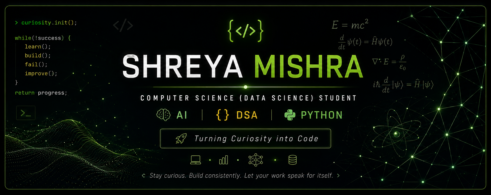

  

<h1 align="center">Shreya Mishra</h1>

  <i>Computer Science (Data Science) Student</i>

========================================================================================================

## About Me

- First-Year B.Tech student in **Computer Science (Data Science)**
- Currently learning **C++, Data Structures & Algorithms, Python and Git**
- Exploring **Machine Learning and Data Science**
- I enjoy solving problems and building projects that improve my programming skills.
- My curiosity for Physics naturally led me towards Artificial Intelligence and Data Science.

---

## Current Focus

-  Learning Data Structures & Algorithms with C++
-  Exploring Python & Machine Learning
-  Building a strong Computer Science foundation
-  One commit at a time, one step closer every day

---

## Tech Stack

### Languages

### Tools

---

## Featured Projects

### Amazon Grocery Demand Forecasting

Forecasting grocery demand using Machine Learning and Time Series Analysis.

**Tech Stack:** Python • Pandas • NumPy.

### DSA in C++
My journey of learning Data Structures & Algorithms with clean and well-documented C++ solutions.

---

## GitHub Streak

---

## Connect with me on

---

